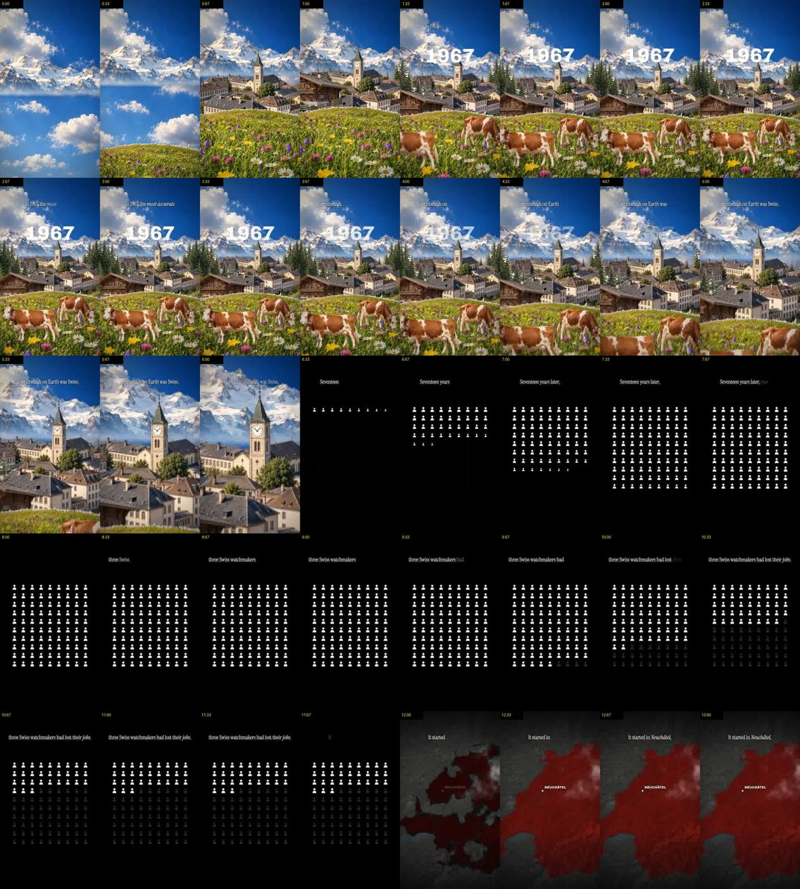

# reel-teardown

A Claude Code skill that takes any short video (a reel, a TikTok, a YouTube Short, an ad) and tells you **why it works**:
the hook, every cut, the pacing, the on-screen text, the script and the ending. Everything is measured from the frames
and the transcript, with timecodes, not guessed.

Paste a competitor's reel and ask *"why does this perform?"* You get a breakdown you can act on, ending in
**3–5 moves to steal tomorrow**.

<p align="center"></p>
<p align="center"><sub>What Claude reads: a frame every 0.33 s, time printed on each. Example: <a href="examples/quartz/BREAKDOWN.md">full teardown of my reel <i>Quartz</i></a>.</sub></p>

## What you get
For each video, a study folder with:
- `sheets/`: contact sheets, a frame every 0.33 s, so no cut is missed
- `transcript.txt`: every word with its timestamp
- `stats.txt`: duration, shot count, average and longest shot, words per second, what happens in the first 3 s
- `BREAKDOWN.md`: Claude's teardown, covering the hook (0–3 s), beat by beat, what keeps people watching, the script, the ending, **steal this**, don't copy

See [examples/quartz/BREAKDOWN.md](examples/quartz/BREAKDOWN.md) for a real one.

## Install
You need [Claude Code](https://claude.com/claude-code) and [uv](https://docs.astral.sh/uv/). uv fetches everything else
on the fly, ffmpeg and Whisper included.

```bash
git clone https://github.com/krlaribi/reel-teardown
cp -r reel-teardown/skills/reel-teardown ~/.claude/skills/
```

## Use
In Claude Code:

> Tear down this reel: https://www.youtube.com/shorts/…

> Why does this ad work? ~/Downloads/competitor-ad.mp4

> Compare my reel out/v3.mp4 with this one and tell me the three biggest differences.

Links are downloaded with yt-dlp. If a platform needs a login (Instagram often does), save the video yourself and give Claude the file.

Prefer no Claude? The measuring script runs on its own:
```bash
uv run --with pillow --with imageio-ffmpeg --with faster-whisper python skills/reel-teardown/scripts/teardown.py study/ video.mp4
```

## Fair use
Study videos to learn from them. Don't republish other people's videos or frames.

## Why I built it
I'm a marketer. About a third of my Claude Code sessions started with "study this reel." This skill is that habit, made repeatable.
More tools: [reel-kit](https://github.com/krlaribi/reel-kit). Reels: [@anatomyofideass](https://www.instagram.com/anatomyofideass/).

## Licence
MIT. See [LICENSE](LICENSE).
